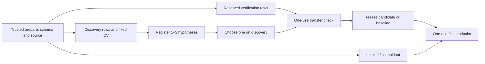

# Selection discipline and the leakage boundary

An adaptive search remembers the best dev result. Extra screens, correlations,
and guard metrics do not erase that selection. This project's conservative
policy is to spend verification evidence once on a small pre-specified family.
The policy comes from the research brief; the demonstration is not a validation
of universal statistical guarantees.

Preparation validates and preprocesses without fitting, and persists IDs,
partitions, seeds, hashes, and separate materialized CSVs. Source, discovery,
verification and holdout IDs must not overlap across their intended boundaries.
External holdouts also enforce disjoint groups if a group column is declared.
For random holdout, groups may overlap by design; choose group holdout to require
new-group evaluation. Group CV uses randomized group-disjoint re-splits; LOGO
uses each group once as validation. Random CV uses stratified folds. Because
there is no fitted rule or imputer, CV's training side is not used to fit anything.

`dev.py` only loads `dev/discovery.csv` plus sealed, source-free feature metadata.
It cannot call the preparation loader through its API and does not import the
final endpoint. `transfer.py` alone consumes verifier data; `final.py` alone
opens the holdout after the frozen decision. Immutable snapshot hashes detect
accidental edits. The tests deny source/verifier/vault reads during dev.
`final` has no rule option and no force/reset option. A failed or concurrent
second attempt cannot reopen the data through the endpoint.

This is an architectural boundary against accidental leakage, not adversarial
filesystem security. The same OS user can deliberately open source or vault
files or rewrite both a snapshot and its seal. For stronger isolation, run the
discovery agent with only the dev directory and an external evaluation service.
Deleting `work/` does not scientifically replenish used evidence.

The split-positive verifier is disjoint in rows, including positives, but may
share systems with discovery. It checks transfer within systems. Group-reserved
verification is configurable for a stronger shift test when enough groups exist.
The example's final system is disjoint from both pool halves. The demonstration
uses just two candidates; even a passing transfer check is evidence for that
comparison, not proof of general optimality.

Selection compares discovery means for a registered family of 1–3 candidates.
Only candidates improving the fixed primary metric and satisfying fixed ROC,
PR-AUC and precision@K tolerances are eligible. The chosen candidate is compared
with the baseline on reserved verification. It must improve the primary metric
beyond `minimum_transfer_gain` and pass the guards again. Otherwise the baseline
is frozen. Undefined guard metrics fail closed. The record reports discovery
gain, transfer gain and their difference (an observed optimism gap), not a
confidence bound. One-use verification ends the campaign even if it succeeds.

The repeated-CV summary first averages folds within each repeat, then reports
the mean and sample SD over repeats. `fold_summary` also reports variability
across fold measurements, which are correlated across repeats. LOGO natural
metrics repeat exactly; only the balanced subsample can change with seed.
Zero repeat SD in LOGO says nothing about uncertainty across unseen systems.
Do not turn repeated partitions into independent-sample confidence intervals.

ROC-AUC uses natural prevalence. Balanced ROC-AUC uses a seeded equal-class
subsample. PR-AUC means **average precision**, not trapezoidal PR area.
Partial AUC is scikit-learn's standardized ROC area up to fixed `max_fpr`.
`success@K` is the number of positives among the first K rows, `precision@K`
is hits/min(K,n), and `recall@K` is hits/total positives. `effective_k@K` exposes
small-fold truncation. Scores tie-break by stable candidate ID, never labels.
Single-class folds return null AUC/AP and report valid/total coverage.

Optionally set an externally known `target_prevalence=p` **before preparation**.
Negatives receive weight `n_positive*(1-p)/(p*n_negative)` and positives weight
one. Matched ROC/AP/partial-AUC are supplemental metrics; class-constant weights
leave ROC unchanged while AP can change. Top-K retains its natural-population
meaning. If no external ratio is available, `match_holdout_prevalence=true`
explicitly authorizes preparation to disclose only the holdout's aggregate
positive rate and freeze it. This is label-derived information and is off by
default. Dev still never reads holdout rows. Never switch policies mid-search.

The cached preprocessed snapshots are keyed by source fingerprint, full config,
partition hash, and preprocessing version. Config/version changes invalidate
reuse and require a new disclosed study directory. Repeated prepare of an
unchanged campaign uses its frozen snapshot and does not re-read mutable sources.
JSON records include the rule, canonical formula, implementation hash, git state,
package versions, dataset/config/partition/cache hashes, exact metric seeds and
all fold/repeat metrics. The append-only JSONL audit links records to verified
post-run commits. Human-readable output is emitted to stdout and can be saved.

Metric definitions follow the primary implementation documentation:
[ROC/standardized partial AUC](https://scikit-learn.org/stable/modules/generated/sklearn.metrics.roc_auc_score.html)
and [average precision](https://scikit-learn.org/stable/modules/generated/sklearn.metrics.average_precision_score.html).
